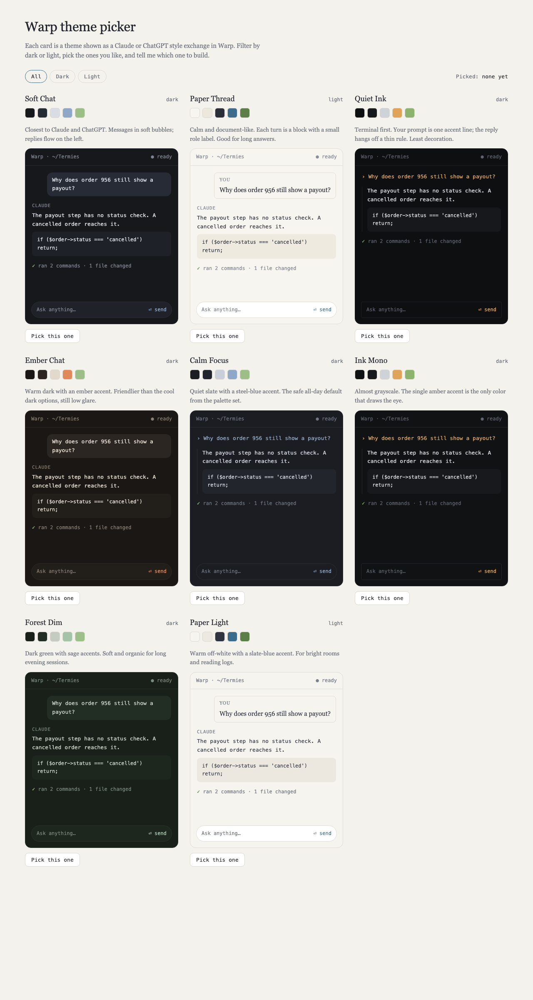

# Termies

Free terminal themes, starting with [Warp](https://www.warp.dev). Every theme is a single YAML file you can install in a few seconds, and a small generator lets you make your own from three colors.



Open [preview/theme-picker.html](preview/theme-picker.html) in a browser to compare all themes side by side. Each card shows the colors and a sample chat exchange.

## Themes

| Theme | Mode | Feel |
|---|---|---|
| Soft Chat | dark | Chat-style, closest to Claude and ChatGPT. Cool slate with a steel-blue accent. |
| Paper Thread | light | Document-like, with a role label on each turn. |
| Quiet Ink | dark | Terminal first. A single amber accent on near black. |
| Ember Chat | dark | Warm dark with an ember accent. |
| Calm Focus | dark | Quiet slate, the all-day default. |
| Ink Mono | dark | Almost grayscale, one amber accent. |
| Forest Dim | dark | Dark green with sage accents, for long sessions. |
| Paper Light | light | Warm off-white with a slate-blue accent. |

## Install

Requirements: Warp, plus a shell that can run `install.sh` (macOS and Linux have one already; Windows users can use Git Bash).

```bash
git clone https://github.com/Engramium/termies.git
cd termies
./install.sh              # install all themes
./install.sh quiet-ink    # or just one
```

The script copies the files into Warp's themes folder:

- macOS: `~/.warp/themes/`
- Linux: `${XDG_DATA_HOME:-~/.local/share}/warp-terminal/themes/`
- Windows (Git Bash): `%APPDATA%\warp\Warp\data\themes\`

Then open Warp, go to **Settings → Appearance → Themes**, and pick the theme.

To install by hand, copy any file from `themes/` into the folder above.

## Make your own

```bash
python3 generator/make_theme.py \
  --name "Dusk Chat" \
  --background "#1C1A24" \
  --foreground "#DCD8E6" \
  --accent "#B49BD9"
```

Add `--mode light` for a light background. The file is written to `themes/`, so you can run `./install.sh dusk-chat` next. The 16 ANSI colors are derived automatically. Edit the generated file if you want to tune any of them.

## What a theme can and can't do

A Warp theme sets colors only: the background, text, accent, and the terminal's ANSI colors. Chat bubbles, rounded input bars, and role labels shown in the preview are not part of a theme file. Layout options such as block spacing and the tab bar are set in Warp's Appearance settings.

## License

MIT. See [LICENSE](LICENSE).
