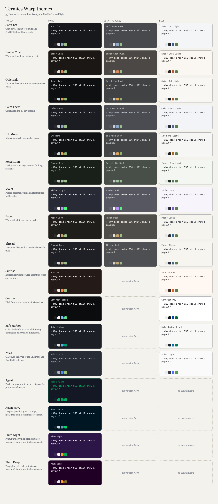

# Termies

Free terminal themes, starting with [Warp](https://www.warp.dev). Every theme is a single YAML file you can install in a few seconds, and a small generator lets you make your own from three colors.



Download [preview/theme-picker.html](preview/theme-picker.html) and open it in a browser for an interactive picker. Each card shows the colors and a sample chat exchange, and you can filter by dark or light, and by mood (calm, energizing, minimal, warm, low light, or bright). Each card also shows its contrast figures, and a color-vision view simulates protanopia, deuteranopia, and tritanopia (approximate).

**Try a theme in your terminal first:** run `python3 scripts/preview_theme.py soft-chat` to see the palette and sample output. It only colors its own output, so your terminal's colors don't change. Use `--list` to see every theme name.

**Generated mockups** for every theme are in [screenshots/generated/](screenshots/generated/). Run `python3 scripts/generate_screenshots.py` to make any that are missing. They're drawn from each theme's palette and are labeled as mockups, not Warp captures.

**Real Warp screenshots** go in [screenshots/warp/](screenshots/warp/), one file per theme. On a Mac, run `./scripts/capture_warp_screenshots.sh` to capture them: it asks you to pick each theme in Warp, then clicks the window for you.

## Reading comfort

Every theme is built for long reading sessions. Text must reach at least 4.5:1 contrast against its background, and colored terminal output must reach 3:1, both checked automatically on every change. The High Contrast themes go further, to 7:1 for text.

## Warp themes

Themes come in families with three moods: a light version, a dark version, and a middle "Dusk" version. In Warp, turn on **Settings → Appearance → Sync with OS** to switch light and dark automatically. Pick a Dusk theme by hand when you want something in between.

| Family | Dark | Light | Dusk (middle) | Feel |
|---|---|---|---|---|
| Soft Chat | `soft-chat` | `soft-chat-light` | `soft-chat-dusk` | Chat-style, closest to Claude and ChatGPT. Steel-blue accent. |
| Ember Chat | `ember-chat` | `ember-chat-light` | `ember-chat-dusk` | Warm dark with an ember accent. |
| Quiet Ink | `quiet-ink` | `quiet-ink-light` | `quiet-ink-dusk` | Terminal first. One amber accent on near black. |
| Calm Focus | `calm-focus` | `calm-focus-light` | `calm-focus-dusk` | Quiet slate, the all-day default. |
| Ink Mono | `ink-mono` | `ink-mono-light` | `ink-mono-dusk` | Almost grayscale, one amber accent. |
| Forest Dim | `forest-dim` | `forest-dim-light` | `forest-dim-dusk` | Dark green with sage accents, for long sessions. |
| Violet | `violet-night` | `violet-day` | `violet-dusk` | Purple-accented, with a palette inspired by Dracula. |
| Paper | `paper-dark` | `paper-light` | `paper-dusk` | Warm off-white and warm dark. |
| Thread | `thread-dark` | `paper-thread` | `thread-dusk` | Document-like, with a role label on each turn. |
| Sunrise | `sunrise` | `sunrise-day` | — | Energizing: warm orange accent for focus and comfort. |
| Contrast | `contrast-night` | `contrast-day` | — | High Contrast, at least 7:1 text contrast. |
| Safe Harbor | `safe-harbor` | `safe-harbor-light` | — | Colorblind-safe: errors and diffs use colors that stay distinct for color vision differences. |
| Atlas | `atlas-dark` | `atlas-light` | — | Classic, in the style of the One Dark and One Light palettes. |
| Agent | `agent-night` | — | — | Dark teal-green, with an accent color for prompts and output. |
| Agent Navy | `agent-navy` | — | — | Deep navy with a green prompt, measured from a terminal screenshot. |
| Plum Night | `plum-night` | — | — | Plum purple with an orange cursor, measured from a terminal screenshot. |
| Plum Deep | `plum-deep` | — | — | Deep plum with a light text color, measured from a terminal screenshot. |

## Recommended font

Themes set colors only. For the font, we recommend [Monaspace](https://github.com/githubnext/monaspace) by GitHub Next, a monospace font family under the SIL Open Font License. Install it, then in Warp go to **Settings → Appearance → Text** and pick a Monaspace font.

## Install Warp themes

**macOS or Linux, in one command** (no clone needed):

```bash
bash <(curl -fsSL https://raw.githubusercontent.com/Engramium/termies/main/install.sh)
```

**Windows, in PowerShell:**

```powershell
irm https://raw.githubusercontent.com/Engramium/termies/main/install-warp.ps1 | iex
```

Both show a numbered menu. Prefer to read the script first? Open [install.sh](install.sh) or [install-warp.ps1](install-warp.ps1), which copy files into Warp's themes folder and do nothing else.

**From a clone**, `./install.sh` works the same way, and `./install.sh soft-chat paper-dark` installs named themes.

The scripts copy the files into Warp's themes folder:

- macOS: `~/.warp/themes/`
- Linux: `${XDG_DATA_HOME:-~/.local/share}/warp-terminal/themes/`
- Windows: `%APPDATA%\warp\Warp\data\themes\`

Then open Warp, go to **Settings → Appearance → Themes**, and pick the theme.

To install by hand, copy any file from `themes/` into the folder above.

Every theme is checked on each push by `scripts/validate_themes.py`. The check covers the file format, hex colors, whether `details` matches the background, and text contrast (at least 4.5:1). You can run it yourself with `pip install pyyaml` and then `python3 scripts/validate_themes.py`.

## Claude Code themes

Every Warp theme also has a Claude Code version, so the same palette covers both tools. The Claude Code files are in [claude-code/themes/](claude-code/themes/).

```bash
./install-claude.sh                     # install all Claude Code themes
./install-claude.sh termies-soft-chat   # or one
```

This copies the files into `~/.claude/themes/`. In Claude Code, run `/theme` and pick a Termies theme. Each Claude Code file is generated from the Warp palette in `themes/`, so edit the Warp YAML and then run `python3 scripts/build_claude_themes.py` to rebuild them. CI fails if the committed Claude Code files are out of date.

## Windows Terminal and iTerm2

Ready-made files for other terminals are in [dist/](dist/), generated from the same palettes.

**Windows Terminal:** open `dist/windows-terminal/termies-<name>.json` and copy its contents. In Windows Terminal, open **Settings → Open JSON file**, add the object to the `"schemes"` list, and set a profile's `"colorScheme"` to the `"name"` value (for example `"Termies Soft Chat"`).

**iTerm2:** double-click a `dist/iterm2/termies-<name>.itermcolors` file to import it. Then go to **Settings → Profiles → Colors → Color Presets** and pick the new preset.

**Ghostty:** run `./install-ghostty.sh` (or one name, like `./install-ghostty.sh termies-soft-chat`). This copies the files into `~/.config/ghostty/themes/`. Then add a line to your Ghostty config:

```
theme = termies-soft-chat
```

Ghostty's config is at `~/.config/ghostty/config`. Reload the config, or restart Ghostty, to apply it.

**kitty:** run `./install-terminals.sh kitty`. This copies the files into `~/.config/kitty/`. Then add this line to `kitty.conf` and reload kitty:

```
include termies-soft-chat.conf
```

**WezTerm:** run `./install-terminals.sh wezterm`. This copies the files into `~/.config/wezterm/colors/`. Then add these lines to your `wezterm.lua`:

```lua
config.color_scheme = 'termies-soft-chat'
config.color_scheme_dirs = { '~/.config/wezterm/colors' }
```

**Alacritty:** run `./install-terminals.sh alacritty`. This copies the files into `~/.config/alacritty/themes/`. Then add this to `alacritty.toml`:

```toml
[general]
import = ["~/.config/alacritty/themes/termies-soft-chat.toml"]
```

Any theme name from `dist/` works in place of `termies-soft-chat`.

## Make your own

```bash
python3 generator/make_theme.py \
  --name "Dusk Chat" \
  --background "#1C1A24" \
  --foreground "#DCD8E6" \
  --accent "#B49BD9"
```

Add `--mode light` for a light background. The file is written to `themes/`, so you can run `./install.sh dusk-chat` next. The 16 ANSI colors are derived automatically. Edit the generated file if you want to tune any of them.

## What a theme can and can't do

A Warp theme sets colors only: the background, text, accent, and the terminal's ANSI colors. Chat bubbles, rounded input bars, and role labels shown in the preview are not part of a theme file. Layout options such as block spacing and the tab bar are set in Warp's Appearance settings.

## Credits and sources

Termies is an independent project. It is not affiliated with any project named below.

- **Violet Night and Violet Day** use the public color values of the Dracula theme. The Dracula VS Code theme is MIT-licensed.
- **Atlas Dark and Atlas Light** use the One Dark and One Light syntax palettes from Atom. Both are MIT-licensed.
- **Safe Harbor** uses the Okabe-Ito colorblind-safe palette (Okabe and Ito, 2008).
- **The color-vision view** uses the Machado, Oliveira, and Fernandes (2009) simulation values, at full severity. They are approximations.
- **Agent Night, Agent Navy, Plum Night, and Plum Deep** were measured from terminal screenshots, not copied from another theme.
- **Contrast thresholds** follow WCAG 2.x.
- **Recommended font:** [Monaspace](https://github.com/githubnext/monaspace) by GitHub Next, under the SIL Open Font License.

## License

MIT. See [LICENSE](LICENSE).
